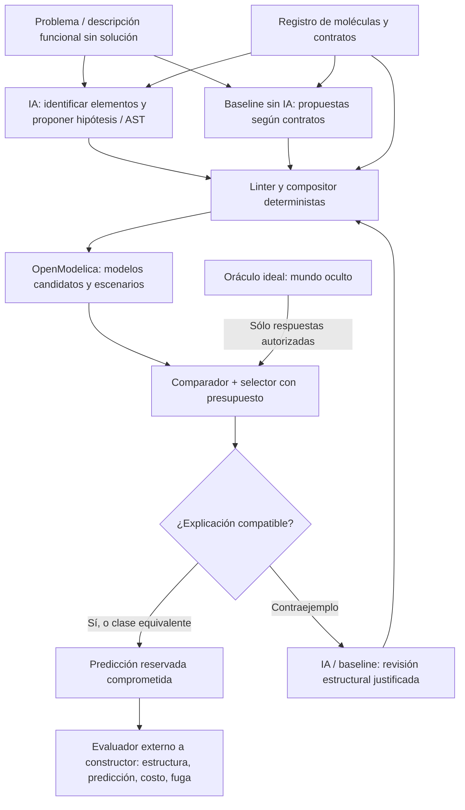
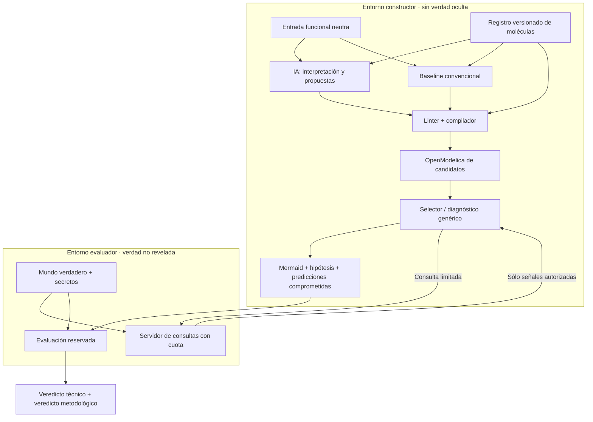
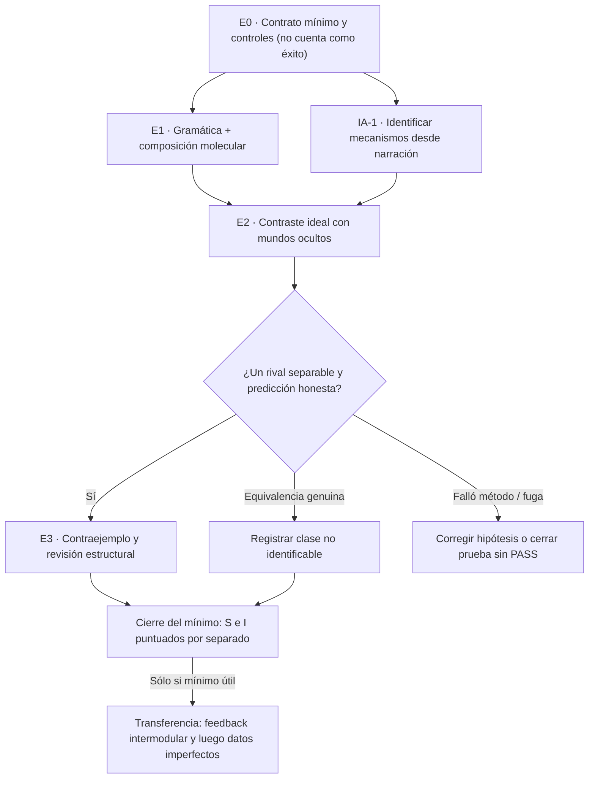
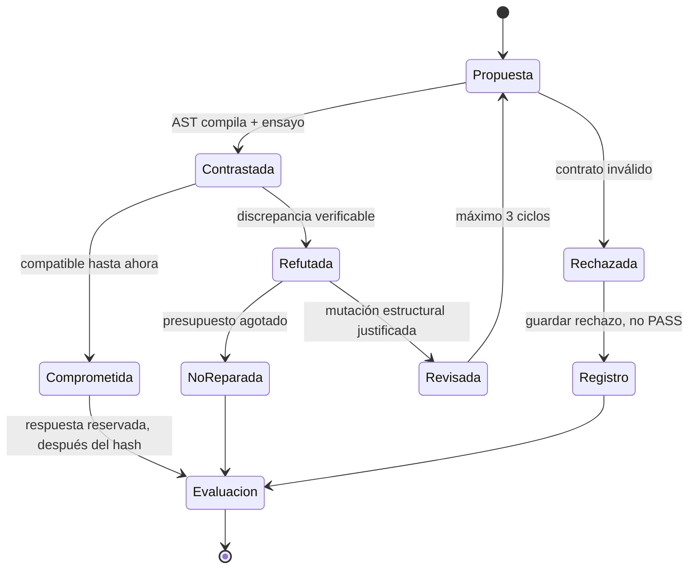

# SD + IGC/CEI — Hoja de ruta consolidada para demostrar el método molecular mínimo

**Versión:** 3.0 · **Corte documental:** 2026-10-18 · **Estado:** propuesta prospectiva consolidada; **ningún experimento descrito aquí está ejecutado por el hecho de aparecer en este documento**.  
**Repositorio:** [`yudocyudoc/short`](https://github.com/yudocyudoc/short).  
**Punto técnico de continuación:** [PR #29](https://github.com/yudocyudoc/short/pull/29), abierto y en borrador.  
**Documentos integrados:** hoja de ruta v1 (17-oct), v2 (18-oct), auditoría de Claude entregada en conversación, revisión compartida como Gemini y el adjunto denominado GLM (cuyo texto se autoidentifica como revisión de Claude). Se integran **los argumentos**, no se cuentan automáticamente como tres auditorías independientes.  
**Naturaleza de los PR:** los PR citados documentan pruebas y artefactos; **no se entienden como fusionados**. El plan no cambia sus resultados históricos.

> **Decisión rectora del investigador.** Primero probar la metodología en un **mundo ideal mínimo**, sin ruido ni documentos contradictorios; después estudiar información imperfecta y datos reales. El método debe **identificar, proponer/componer, graficar, simular, contrastar, proyectar y revisar** modelos con conocimiento SD reutilizable. Un enumerador determinista es infraestructura; por sí solo **no demuestra IGC**. El fracaso de Llama en una tarea **no invalida** la investigación con otros modelos de IA.

> **Regla de oro:** ningún resultado se llamará éxito metodológico si la respuesta ya venía en la descripción, el catálogo de casos, una tabla de firmas, la estructura del generador o las condiciones de aceptación. Un experimento pequeño es valioso solamente si todavía puede fallar por una razón relevante para el objetivo.

---

## 0. Cómo utilizar este documento

Este archivo **sustituye operativamente** a las hojas de ruta v1 y v2; éstas se conservan como antecedentes, pero no rigen la ejecución cuando difieran. Es **la única fuente normativa** para las siguientes pruebas. Los detalles técnicos se concretarán en **un contrato de una página por experimento**, no en nuevos documentos metodológicos extensos. Si aparece una objeción, debe traducirse en un control existente o una decisión de parada; no abrir automáticamente otro frente de investigación.

**Lectura rápida:** §1 fija qué queremos probar; §2 registra qué sabemos; §3 define piezas y roles; §4 define el mundo ideal; §5 describe la arquitectura; §6 contiene las hipótesis; §7 los experimentos y sus puertas; §8 las reglas anti-tautología; §9 el orden de ejecución; §10 las decisiones y límites de la revisión externa.

**Alcance excluido ahora:** estimación con POS, ruido de sensores, Poisson, datos faltantes, calibración empresarial, identificación de campo real, comparación comercial, miles de arquitecturas y nuevas bibliotecas por conveniencia. Son fases posteriores **si** el mínimo ideal se establece. No confundir «fuera de alcance» con «problema resuelto».

---

## 1. Qué queremos probar y qué sería un falso éxito

### 1.1 Pregunta científica y pregunta de ingeniería

**Pregunta metodológica:** con un catálogo pequeño de mecanismos SD reutilizables, una descripción funcional que **no revele la solución** y acceso limitado a intervenciones de un mundo ideal, ¿puede IGC **formular alternativas estructurales**, escoger pruebas informativas, distinguir o reconocer equivalencias, comprometer predicciones no vistas y **revisar una estructura ante un contraejemplo**?

**Pregunta sobre IA:** ¿puede un modelo de lenguaje **extraer mecanismos/roles relevantes del problema** y proponer o revisar una arquitectura de manera comprobable, sin que el prompt ni el código le proporcionen ya la respuesta? ¿En qué tareas y bajo qué presupuestos aporta utilidad frente a algoritmos convencionales?

**Pregunta de ingeniería subordinada:** ¿existe un compositor por **contratos moleculares**, no por `if scenario_id` ni por una lista fija de grafos, que produzca modelos Modelica válidos a partir de instancias de clases verificadas?

Estas tres preguntas tienen **veredictos independientes**. Una puede pasar y las otras fallar; el documento no permite convertir PASS de compilación en PASS causal.

### 1.2 Recorrido mínimo del método



**Condición necesaria:** el oráculo y el evaluador conocen la verdad; el constructor y los modelos de IA **no**. El constructor no recibe arquitectura/etiqueta verdadera ni la respuesta de la intervención reservada. El evaluador no modifica el método después de observar resultados.

### 1.3 Qué NO bastará para declarar «método demostrado»

- Reproducir una serie de un modelo ya proporcionado, cambiar nombres de nodos o acertar una firma binaria incrustada en el código.
- Enumerar 4 o 6 grafos con interruptores (`TRANSIT` sí/no; `REPORT_FILTER` sí/no) y llamar a eso composición abierta.
- Elegir entre dos **macros completas** (MTO/MTS) y llamarlo ensamblaje molecular.
- Demostrar que una estructura genera las mismas series que sí misma con iguales parámetros. Es una regresión necesaria, no identificación.
- Entregar a la IA frases como «dos colas», «filtro de primer orden» o resúmenes diagnósticos hechos a la medida de la solución.
- Elegir una intervención *después* de consultar la respuesta verdadera, o ajustar modelos sobre la intervención supuestamente reservada.
- Cambiar al siguiente grafo enumerado y presentar ese `backtracking` como revisión causal fundamentada.
- Usar ruido artificialmente fácil de rechazar para mostrar que un guard «acierta»; la auditoría del #31 ya mostró este riesgo.

---

## 2. Antecedentes comprobados y límites históricos

Los resultados de GitHub son **evidencia de lo que se ejecutó**, no prueba automática del propósito metodológico. Resumen conservador:

| Referencia | Demostración disponible | Límite para esta hoja de ruta |
|---|---|---|
| [#1–#4](https://github.com/yudocyudoc/short/pull/4) | IGC-0 sintético, analista y controles; rechazo real de grafo LLM estructuralmente inválido | No hubo construcción válida del sistema investigado |
| [#5–#6](https://github.com/yudocyudoc/short/pull/6), [#16](https://github.com/yudocyudoc/short/pull/16), [#17](https://github.com/yudocyudoc/short/pull/17) | Moléculas originales Hines verificadas con PySD; paridad S1 y S2 con OpenModelica / SystemDynamics; colas, stocks y flujos ejecutables | Compatibilidad numérica, no recuperación causal automática |
| [#18](https://github.com/yudocyudoc/short/pull/18) y [#19](https://github.com/yudocyudoc/short/pull/19) | Selección restringida con Llama 7/8 estricta en #18; construcción LLM-Modelica 0/4 estricta en #19 | Interpretar/seleccionar ≠ componer correctamente |
| [#20](https://github.com/yudocyudoc/short/pull/20) | Gramática IGC-SL propuesta | Documento de diseño, no implementación probada |
| [#21](https://github.com/yudocyudoc/short/pull/21) | En 12 casos propios: molecular 11/12, Llama general 9/12, baseline determinista 12/12 | Muestra construida con sus reglas, no ventaja del LLM |
| [#22](https://github.com/yudocyudoc/short/pull/22), [#23](https://github.com/yudocyudoc/short/pull/23), [#24](https://github.com/yudocyudoc/short/pull/24) | #22 fue sustituido por #23; en 24 casos nuevos #23: molecular 18/24 frente a SD general 15/24 y regex 10/24; #24 bloqueó evaluación por referencia insuficiente | Promesa exploratoria, no prueba independiente de recuperación estructural |
| [#25](https://github.com/yudocyudoc/short/pull/25) | AST real de Llama: cuatro roles y tres conexiones; ejecución OM y paridad S2 | Topología casi preasignada; ninguna reparación genuina |
| [#26](https://github.com/yudocyudoc/short/pull/26) | Llama 3/12 estricto, **0/9 `COMPOSE` admitidos**, 11/12 intención **post hoc**; baseline léxico 8/12, unificador de tipos 2/12 | Selección semántica parcial, formato/evidencia todavía impiden composiciones |
| [#27](https://github.com/yudocyudoc/short/pull/27) | Dos macros completas MTO/MTS, contrafactual OM, crítico 4/4 en casos propios | Selección de macro, no generación de arquitectura molecular |
| [#28](https://github.com/yudocyudoc/short/pull/28) | Una cola física opcional genera dos grafos, dos pruebas OM; crítico 3/4 admitido | Primer ensamblaje variable, aun acotado |
| **[#29](https://github.com/yudocyudoc/short/pull/29)** | **Dos mecanismos opcionales distintos**, cuatro grafos, ocho simulaciones, filtro informacional sin efecto físico; Llama 6/8 | **Punto de partida**; `itertools.product` de dos booleanos, no compositor general |
| [#30](https://github.com/yudocyudoc/short/pull/30) | Procedencia y disponibilidad de señales, 12 casos sintéticos | Rama lateral; no cierra composición/identificación ideal |
| [#31](https://github.com/yudocyudoc/short/pull/31) | Sensores acotados con 40 casos derivados de ocho mundos; 20 vs 0 falsos descartes de dos reglas | Resultado esencialmente condicionado por cotas verdaderas por construcción; **no avance de identificación** |

**Dos aprendizajes de auditoría obligatorios:**

1. En `experiments/dual-mechanism-v1/analyze.py` (#29), `LAG` equivale operativamente a `max|a-b| > 1e-6`: **diferencia de tasas no prueba retardo temporal**. Además `next_experiment` elige por Gini entre **tres firmas de comparación precalculadas**, cotejadas con una tabla esperada escrita en código (`INCORRECT_MOLECULAR_SIGNATURE`). Es útil como **regresión**, no como descubrimiento de intervención.
2. En #31, el método que sólo permite refutar igualdades nunca elimina `TransitAndReport`, cuya firma obliga a diferencias en los tres pares. El 0/40 bajo cotas correctas es esperado matemáticamente. No reproducir un éxito condicionado por el gate como si fuese nueva capacidad del sistema.

**Trazabilidad:** la observación «integración técnica ≠ composición/descubrimiento» ya surgió durante la revisión de **#25**, corroborada por el informe de #26; no atribuir su origen a la crítica del #31. Los números de la tabla conservan sus alcances **estrictos vs post hoc**.

---

## 3. Moléculas, roles y arquitectura causal que sí tenemos

### 3.1 Catálogo de partida: no inventar matemáticas

| Elemento / rol | Clase reutilizable o fundamento | Función y contrato | Condición para usarlo |
|---|---|---|---|
| Fuente de pedidos | `IGCMolecules.AcceptedSource` | Fuente de `FLOW<Order>` | Exógeno y tipado |
| Preparación | Instancia `IGCMolecules.BoundedQueue` | `FLOW<Order> → FLOW<ReadyOrder>` mediante adaptaciones registradas; stock, tasa, capacidad | Unidad, stock inicial y política declarados |
| Despacho | Instancia `IGCMolecules.BoundedQueue` | `FLOW<ReadyOrder> → FLOW<Shipment>` mediante adaptaciones registradas | No confundir con entrega |
| Transporte físico | Instancia adicional `IGCMolecules.BoundedQueue` | `FLOW<Shipment> → FLOW<Shipment>`; tránsito acumulado y liberación acotada | Cada instancia es rol, no nueva clase/mecanismo |
| Entrega / acumulado | `IGCMolecules.DeliveryCounter` | Recibe flujo material y cuenta entregas | Señales informativas separadas |
| Reporte | `IGCInformationMolecules.FirstOrderReportFilter` | `SIGNAL<DeliveryRate> → SIGNAL<DeliveryRate>`; no mueve material | El contrato garantiza no-intrusión física |
| Referencias S1/MTS y S2/MTO | Hines / SystemDynamics / MSL / wrappers IGC | Modelos de comparación previamente ejecutados | Una macro completa no se convierte en molécula nueva por renombrarla |

**Precisión semántica:** el código IGC usa *wrappers* propios sobre bloques SystemDynamics/MSL; eso no equivale a haber incorporado libremente todas las moléculas originales de Hines ni `BusinessSimulation.MoleculesOfStructure`.

**Acerca del feedback:** la cadena de módulos es predominantemente **feedforward** entre etapas; cada `BoundedQueue` regula su tasa de salida por su stock y capacidad (realimentación local estado–tasa). No hemos demostrado composición de **bucles de política intermodulares cerrados**, que será objetivo de transferencia posterior. Ni «ningún feedback» ni «SD general ya validada» son descripciones correctas.

### 3.2 Gráfico de tipos: material ≠ señal


El diagrama representa la familia de componentes, **no afirma que el generador ya pueda enumerarla sin plantillas**. Multiplicidad `0..n` es **límite de recursos declarado por el experimento**, no un interruptor ad hoc en el código de composición. Una cascada homogénea de dos colas es legítima como estructura dinámica distinta, pero no se rotularán sus etapas («consolidación» y «transporte») como mecanismos sustantivamente diferentes si los contratos no lo justifican.

### 3.3 Contrato mínimo de cada molécula registrada

Toda entrada del registro debe incluir: `class_id`/versión/fuente verificada y plantilla ejecutable; roles permitidos; puertos con **tipo material/información**, unidad, causalidad y cardinalidad; parámetros y rangos admisibles; estado inicial; reglas de conservación/no-intrusión; limitaciones de capacidad y saturación; y sondas de regresión. El AST sólo instancia y conecta; **no escribe nuevas ecuaciones diferenciales**.

**Separar H1 de H2:** un AST escrito manualmente que representa todas las variantes válidas demuestra **expresividad de la gramática** (H1). Que **el compositor las derive sin reglas por nombre de escenario** prueba otra cosa (H2).

---

## 4. Contrato del mundo ideal — pequeño, exacto y no trivial

«Ideal» no significa que el constructor reciba el grafo verdadero. Significa que el evaluador dispone de la arquitectura exacta, los parámetros verdaderos, las series sin ruido y los resultados de cualquier intervención admitida. El constructor sólo recibe la vista predefinida y una **cantidad limitada de respuestas**.

### 4.1 Dos perfiles de observación exacta

| Señal | Naturaleza | Perfil P: físico + informacional (principal) | Perfil Q: sólo tablero (diagnóstico de equivalencias) |
|---|---|---|---|
| `dispatchRate` | Tasa de despacho | Visible | No visible |
| `deliveryRate` | Tasa de recepción física | Visible | No visible |
| `inTransit` **agregado** | Stock físico acumulado | Visible | No visible |
| `reportedDeliveryRate` | Señal del panel | Visible | Visible |
| Stock de cada cola oculta | Estado interno | Oculto | Oculto |
| Identidad/orden de moléculas | Estructura | Oculto | Oculto |

**Por qué ambos:** bajo Q algunas cascadas de retardo físico y de reporte pueden producir la **misma señal**, incluso con exactitud perfecta. Es un resultado **de no-identificabilidad bajo observación**, no un defecto de datos. Bajo P ciertas alternativas se separan por recepción física o stock en tránsito. El perfil usado y sus señales se anuncian **antes de generar mundos**; la prueba principal es P, Q no se suma artificialmente a los «aciertos».

### 4.2 Descripción funcional neutra (control de fuga)

Plantilla común sugerida: «Un sistema acepta pedidos, los prepara y despacha; existe una recepción física y un indicador de entregas. Su objetivo es atender los pedidos; se dispone de las señales de la tabla y puede aplicarse una intervención del menú». No incluir palabras que revelen estructura oculta: «dos almacenes», «segundo transporte», «filtro», «primer orden», nombre del mundo ni identificadores de moléculas verdaderas.

**Prueba:** un lector ciego que vea **sólo la descripción** no debería poder reconstruir más que la función general compartida. Si la recupera por nombres o redacción, corregir **antes de la primera corrida**; después se registra el fallo y se prepara un conjunto nuevo sin reciclar su puntuación.

### 4.3 Parámetros e identificabilidad: distinguir dos preguntas

- **P0 — estructura a parámetros controlados (primer gate):** la política de asignación y una **rejilla pública finita** de valores admisibles se fijan antes; el evaluador escoge y sella para cada mundo una configuración de esa rejilla y el constructor puede simular la **misma rejilla para todos los candidatos**, sin recibir la elección verdadera del caso. La comparación sólo autoriza conclusiones **dentro de la rejilla**. Cuando se compare el orden de una cadena, mantener una escala de residencia total equivalente cuando sea físicamente posible (p. ej. una etapa `τ=T` frente a dos con `τ=T/2`) para evitar que «más lento» sea la única clave. No extrapolar esa equivalencia a regímenes saturados.
- **P1 — compensación de parámetros (gate posterior, sólo si P0 es informativo):** cajas de parámetros y condiciones iniciales fijadas previamente por clase/escenario; calibración idéntica en cada candidato, sólo con los datos de entrenamiento. Una **búsqueda numérica finita** que no encuentra parámetros compatibles **no demuestra** inexistencia de solución continua: `UNRESOLVED_PARAMETER_SEARCH` salvo certificación válida de incompatibilidad.
- **Norma de descarte:** no eliminar estructura por mal ajuste de **una** parametrización elegida si todavía podrían existir otras dentro de sus rangos declarados. Si se usa una rejilla finita declarada como universo del ensayo, el veredicto de descarte se limita **a esa rejilla**, no a todos los valores reales.

### 4.4 Excitaciones, saturación y presupuesto de oráculo

Menú finito predefinido con amplitud, duración y ventana: **pulso**, **escalón**, **rampa** y **pulso de capacidad alta**. Ninguna es «discriminante» sólo por su nombre: se comprueba en las series si cruza un umbral relevante y si realmente **separa al menos un par** de modelos bajo la vista declarada. Variaciones de capacidad 3, 5 u 8/h no se consideran separadoras por decreto.

**Por mundo:** 1 respuesta inicial de entrenamiento + **1 elección discriminante** entre las intervenciones autorizadas + **1 respuesta reservada** para puntuación = **máximo tres respuestas del oráculo**, además de la descripción funcional. Para evitar postdicción, el **perfil** de la intervención reservada se publica antes del compromiso; su **respuesta** queda oculta hasta puntuar. El selector puede simular candidatos; su número de simulaciones y llamadas se contabiliza por brazo.

**Métrica numérica:** rejilla común anunciada, unidades verificadas, norma `max_abs_error` y RMSE; `error_bound` independiente definido a partir de control de precisión del solver, no de la respuesta del mundo. Etiquetas: `COMPATIBLE`, `DIFFERENT_NUMERICALLY`, `TEMPORAL_SHIFT_ESTIMATED` sólo si hay estimador temporal válido, `EQUIVALENT_UNDER_MENU`, `NOT_IDENTIFIABLE`, `UNRESOLVED_PARAMETER_SEARCH`. **Prohibido el antiguo `LAG = distinto`.**

### 4.5 Matriz previa de separabilidad

Antes de puntuar métodos, calcular **en el lado evaluador** qué pares de estructuras son separables con el menú/observables/política de parámetros. Registrar matriz: `{par, perfil, intervención, salida, criterio de separación, estado}`. Separar `SEPARABLE_UNDER_CONTRACT` de `EQUIVALENT_UNDER_CONTRACT` y `UNRESOLVED`. No mostrar la **identidad verdadera** ni la matriz-respuesta al constructor; éste debe producir sus propias predicciones desde candidatos.

La matriz sirve tanto para evitar **PASS predeterminado** como **FAIL imposible**. **No** sirve para insertar el test ganador en el prompt ni fabricar un escenario después de conocer qué elige el sistema.

### 4.6 Sellado y secretos del mundo

1. Congelar constructor, contratos, menú, criterios, semillas y prompts de cada brazo.
2. Generar manifiesto de mundos verdaderos y respuesta reservada en el evaluador; publicar compromiso `SHA-256(sal_secreta || manifiesto)` + commit/timestamp antes de ejecutar casos. La sal debe permanecer fuera del espacio accesible por constructor; un hash sin sal es vulnerable a enumeración si sólo hay seis mundos.
3. Ejecutar constructor sin lectura del gold, secretos ni respuestas reservadas. Idealmente separar procesos/jobs/permisos de constructor y evaluador; no confiar sólo en «no poner el campo truth en el prompt» si el archivo está en su filesystem.
4. Registrar todas las consultas al oráculo, también las fallidas. Sin consultas extra invisibles ni reejecuciones exploratorias presentadas como primera prueba.
5. Abrir la verdad **después** de que estén comprometidos ASTs y predicciones; conservar originales y auditoría de separación.

---

## 5. Arquitectura de software, herramientas y responsabilidad

| Capa | Tecnología ya usada | Responsabilidad y límite |
|---|---|---|
| Repositorio/versiones | GitHub + Actions + hashes | Evidencia, CI, separación de ramas y artefactos; **CI verde ≠ método aprobado** |
| Registro/modelo declarativo | JSON/AST + Python | Tipos, interfaces, unidades, roles, límites, trazabilidad y reglas de composición |
| Generador de candidatos | Python determinista inicialmente | Resolver puertos y reglas; sin `if` por ID de mundo ni listado de respuestas |
| Motor dinámico | OpenModelica **1.26.5**, MSL **4.0.0**, SystemDynamics **2.1.2** | Simular clases verificadas; parámetros provienen del backend |
| Referencias anteriores | PySD **3.14.3**, Hines verificado | Paridad/regresión cuando aporte, no rehacer validaciones sin motivo |
| IA | Llama disponible y otros modelos más capaces cuando haya acceso | Identificar, proponer AST, cuestionar hipótesis, elegir prueba, reparar, explicar; **no calcular el oráculo ni escribir EDOs libres** |
| Comparador / selector | Python con normas numéricas y presupuesto | Comparar series y proponer excitaciones sin consultar la respuesta verdadera |
| Evaluador | Proceso aislado + revisión externa | Contiene verdad reservada; adjudica capacidades y fugas |
| Representación | Mermaid/estructura SFD derivados del AST | Diagrama fiel a nodos/aristas del modelo, no dibujo generativo arbitrario |



**Interfaz con IA:** puede ver descripción funcional, catálogo, ASTs disponibles, series autorizadas o una **transducción genérica y agnóstica** (tasas/errores/perfiles), no una frase escrita para ese mundo como «falta una cola de tránsito». Un fact ID existente demuestra referencia sintáctica, **no** respaldo causal: auditar semántica separadamente.

---

## 6. Hipótesis y evidencia que permitiría refutarlas

Dos carriles: **S = sustrato SD verificable** e **I = capacidades IA/IGC**. No degradar I a opcional «si sobra tiempo»; sin ese carril sólo tendremos un sistema de búsqueda estructural convencional.

| ID | Hipótesis verificable | Control necesario | Fracaso genuino / resultado no adjudicable |
|---|---|---|---|
| **S1 — Expresividad** | Registro/AST expresa cada estructura válida de la biblioteca cerrada | ASTs manuales independientes y linter | Una estructura válida no puede expresarse, o estructura inválida pasa |
| **S2 — Composición** | Un compositor genérico deriva instancias/conexiones desde contratos, sin precablear el universo | Intercambio de registro **sin modificar compositor**, auditoría, canonicidad y negativos | Sólo cambia topologías mediante `if`, alias de macros o plantillas por grafo |
| **S3 — Contraste** | Una prueba elegida **antes del oráculo** separa un rival separable y produce partición predicha correcta | Selector fijo/aleatorio, matriz a priori sellada y presupuesto de consultas | Sólo lee firmas en tabla, consulta más de lo permitido o selecciona prueba que no separa |
| **S4 — Predicción** | El candidato seleccionado predice una intervención reservada no usada para ajustarlo | Compromiso de trayectoria + exactitud bajo `error_bound` | Ajuste retrospectivo, error fuera de cota o verdad revelada antes |
| **S5 — Revisión** | Tras refutación, propone mutación estructural razonada que mejora una predicción distinta | Exhaustiva/BFS con igual presupuesto y diff automático | Sólo salta al siguiente nombre, cambia números/formato o el reparado estaba en la lista inicial |
| **I1 — Identificación** | Modelo de IA extrae y estructura entidades, stocks, flujos, señales, fronteras y hechos desde descripciones neutrales inéditas | Baseline lexical, rúbrica independiente por componente, gold inaccesible | Roles inventados, omisiones, evidencia textual sin soporte causal |
| **I2 — Propuesta arquitectónica** | IA plantea al menos una conexión/alternativa ejecutable y sustantiva desde el registro, sin que la topología venga en el prompt | Linter, compilador y comparación con generador ciego | Propone sólo lo nombrado explícitamente, enlaces inválidos o macros completas |
| **I3 — Crítica/prueba/reparación** | IA aporta una decisión verificable sobre qué probar o cómo modificar estructura | Mismo contexto y presupuesto que el baseline; compromiso antes de probar | Diagnóstico prefabricado, más simulaciones que control, corrección sin mejora |
| **I4 — Transferencia entre modelos** | Evaluar la misma función de IGC con Llama y al menos un modelo más capaz si disponible | Adaptadores comparables, outputs originales, costo y resultado por modelo | No comparar modelos por accesos o presupuestos distintos; **INCONCLUSIVE**, no «la IA no sirve» |

**Aclaración estratégica:** S1–S4 aprobadas **no bastan** para declarar IGC validado. I1–I3 deben producir al menos un resultado independiente en casos no triviales; I4 informa alcance y progresión de modelos, no es una condición universal para que exista un prototipo útil. No usar pocos casos para afirmar superioridad estadística; con conjuntos pequeños dar **resultados descriptivos por caso** y coste, no significancia.

---

## 7. Hoja de ruta ejecutable: cuatro experimentos centrales y transferencia posterior



### E0 — Preparación de un contrato falsable (una sola puerta, no 20 subproyectos)

**Pregunta:** ¿están definidos los observables, el universo pequeño, las responsabilidades y el falsificador **antes** de ejecutar? **E0 nunca equivale a demostrar IGC.**

**Entregables mínimos y cerrados:**

1. Registro versionado de las clases existentes, parámetros/cotas/estados iniciales, compatibilidad material–señal, una canonicidad de grafos sin IDs de instancias, ejemplos AST válidos e inválidos.
2. Menú de perfiles P/Q, intervenciones (perfil y amplitud), máximo tres consultas del mundo, tolerancia `error_bound` de solver, métricas `max_abs_error`/RMSE y simulaciones máximas por brazo.
3. Matriz de separabilidad calculada **en el evaluador**, señalando equivalencias/no identificabilidad; si no existen rivales separables, **rediseñar el universo antes de iniciar E2**, no declarar fallo del selector.
4. Procedimiento de mundo sellado y entrada neutra; ejecutor sin acceso a la verdad, predicción numérica comprometida antes de la respuesta reservada.
5. Baselines escritos: compositor viejo #29, enumeración exhaustiva de grafos válidos, selector fijo/aleatorio, baseline lexical para IA y criterio de entrega por IA.
6. Tabla única **hipótesis → métrica → umbral → límite de consultas → estado** para el primer lote (ver §6 y contrato E0 de una página); política de no reintentos oportunistas.

**Contención:** máximo **un PR de preparación**, con contrato breve y tests; no introducir nuevas ecuaciones ni sensores. Si E0 no puede cerrarse con lo existente, registrar el bloqueo técnico en lugar de ampliar la hoja de ruta.

### E1 — Composición desde registro, no tercer interruptor

**Objetivo S1/S2:** probar gramática y compositor genérico. **No declarar todavía IGC.**

**Ejecución:**

1. Elaborar manualmente los AST válidos y negativos, **sin depender del compositor**; comprobar que la gramática los expresa (S1).
2. Ejecutar compositor sobre el registro actual: reproducir por contratos los cuatro grafos del #29 y cualquier variante adicional admitida por un límite externo finito de instancias. **No usar éxito «6 contra 4»** como métrica metodológica.
3. Auditar que el código **no contiene** tabla de variantes, nombres de mundo, `for transit_stages in (0,1,2)` como sustituto de resolver puertos, ni caso especial por grafos conocidos.
4. **Prueba decisiva de intercambio de registro:** incorporar en el **archivo de registro** otra instancia/clase **con backend ya verificado** y puertos compatibles, sin cambiar ni una línea del compositor. El algoritmo debe explorar la nueva combinación; si sólo es alias idéntico, no contar como nuevo mecanismo, pero sí probar extensibilidad de lectura de registro. Si es técnicamente necesario agregar un adaptador Modelica, separarlo del compositor y no atribuir ese trabajo a composición autónoma.
5. Canonicalizar: nombres de instancias permutados colisionan; cambiar estructura tipada no; los cuatro originales tienen cuatro canon diferentes. Negativos: señal conectada como flujo, unidad errónea, fuente ausente, rol no permitido, componente duplicado sin función.
6. Compilar y simular los grafos nuevos que el contrato autorice; comprobar conservación, no-intrusión del filtro informacional y ausencia de ecuaciones generadas por IA.

**Gate:** S1 = todas las estructuras válidas **del universo predefinido** representables y negativos rechazados; S2 = intercambio sin cambios del compositor + auditoría sin rutas por escenario + canonicidad/completitud y al menos un grafo nuevo derivado por la gramática. Registrar `N_intentados`, `N_validos`, `N_canónicos_distintos`, `N_compilados` y las causas de rechazo. Si el conjunto sólo tiene seis, llamar al resultado **motor composicional de escala pequeña**, no explorador causal general.

**Comparador:** enumerador #29. No es necesario que S2 lo supere en rapidez; debe demostrar un **mecanismo distinto y extensible**.

### IA-1 — Identificación y propuesta (arranca con E0/E1, no al final)

**Objetivo I1/I2:** medir el aporte central de IA desde lenguaje. Un set de descripciones funcionales inéditas, redactadas **sin topologías nombradas**, con algunos casos que compartan palabras pero requieran mecanismos distintos y otros que tengan evidencia insuficiente.

**Entradas:** descripción neutra + registro público (sin verdad) + presupuesto fijo; **no** respuestas del mundo de prueba para el paso de identificación textual. **Salidas:** entidades, tipo de stock/flujo/señal, frontera, hipótesis candidatas, ASTs propuestos, justificación con hechos positivos y `unknown` tipado.

**Evaluación por capas:** (a) extracción y frontera semántica; (b) validez AST/linter; (c) compilación; (d) originalidad estructural (no copiar el prompt); (e) hipótesis causales fundamentadas. **No sumar esas capas como un solo 8/10 ambiguo.**

**Controles:** lexical básico (antecedente 8/12 de #26; no extrapolarlo), generador por contratos sin IA y Llama reproducible. En una segunda vuelta, un modelo **más capaz disponible y autorizado**, con los mismos casos y criterios. Registrar originales, identificador de modelo, prompt y costos. La comparación con pocas viñetas es **exploratoria**. Un fallo de Llama **no detiene** probar otra familia.

**Gate útil:** al menos una propuesta IA **causalmente respaldada, no proporcionada por la descripción, estructuralmente válida y ejecutable** en un caso nuevo; además documentar todos los fallos y la tasa por capacidad. Es **prueba de factibilidad acotada**, no demostración de ventaja estadística. Si no sucede, I1/I2 siguen abiertos sin declarar éxito o fracaso de toda la IA.

### E2 — Contraste ideal, sin ruido y con estructura oculta

**Objetivo S3/S4 e I3 (selección de prueba):** probar que alternativas ejecutables pueden distinguirse **sin leer la clave del mundo**, y que una selección genera predicción bajo intervención no vista.

**Ejecución:**

1. Sellar todo el **universo de mundos** de la biblioteca pequeña, no escoger sólo uno donde el resultado sea obvio. Cubrir cada topología válida al menos una vez bajo parámetros preasignados; si se usa un pequeño barrido de parámetros, reportar mundos correlacionados, no N independientes. Comparar por clase de equivalencia si corresponde.
2. Entrenamiento: respuesta inicial del oráculo, señales declaradas por P/Q, descripción neutra; comparar todas las alternativas sin acceso a `truth`.
3. **Antes** de segunda consulta: selector determina intervención entre menú conocido y publica partición predicha de candidatos y hash; comparar con selector fijo/aleatorio y con exhaustiva en presupuesto de **consultas al mundo**, no sólo de CPU.
4. Consultar una única respuesta discriminante, contrastar series **numéricamente**, no con etiquetas `LAG` heredadas. Descartar sólo modelos/parámetros refutados bajo criterio declarado; si la compatibilidad sobre caja continua no está certificada, `UNRESOLVED`, no poda fuerte.
5. Revelar la **forma de la intervención reservada**, generar y sellar predicciones para todos los sobrevivientes y ASTs propuestos; después el evaluador ejecuta mundo y puntúa `max_abs_error`, número de rivales excluidos justificadamente, presupuesto y clases equivalentes.
6. Informe por mundo y matriz agregada: supervivientes, errores, falsos descartes, equivalencias, consultas, candidatos inválidos, costo; matriz de confusión sólo para casos **realmente distinguibles**. No atribuir una predicción correcta a descubrimiento cuando el generador verdadero estaba disponible en el catálogo: puntuar también falsos supervivientes y si la intervención elegida aportó información.

**Gate:** mostrar en al menos un **par preidentificado como separable** que un método selecciona antes del oráculo un ensayo que separa, sin fuga, y produce predicción reservada compatible; además reportar desempeño **sobre todos los mundos** del universo. Un ejemplo es demostración de funcionamiento, no generalidad; si sólo se salva un mundo por coincidencia y falla en el resto, el veredicto global es **parcial/inconcluso**, nunca PASS universal.

**Fallo informativo:** la biblioteca resulta no separable con observables autorizados: `NOT_IDENTIFIABLE_BY_DESIGN`, **no** culpar al modelo; o el selector falla en pares separables; o la predicción revela generalización falsa. Tras dos bloqueos por la misma causa, rediseñar el gate con versión nueva, no reintentar hasta acertar.

### E3 — Un contraejemplo que requiera reparación auténtica

**Objetivo S5/I3:** frente a un modelo *plausible bajo la primera respuesta*, emitir **antes de simularlo** una modificación estructural explicada por evidencia y comprobar que mejora predicciones en una respuesta adicional no usada para proponerla.

**Precondiciones:** E2 debe contener pares `{A, B}` indistinguibles bajo una excitación pero separables bajo otra. El par, mundo y orden de ensayos se sellan **antes** de observar la primera propuesta; se informa si el caso elegido ofrecía realmente oportunidad de reparación. No fabricar un contraejemplo tras ver la selección de la IA.

**Restricción anti-victoria vacía:** con seis grafos, cambiar al segundo superviviente puede ser lo mismo que enumerar. Para adjudicar «reparación dirigida», el grafo destino debe estar **fuera del conjunto inicial explorado por el brazo** (la biblioteca registrada sí puede contener sus piezas), o la propuesta de mutación debe predecir una mejora causal verificable con menor trabajo que búsqueda exhaustiva. Si el espacio es tan pequeño que esto no se distingue de BFS, **registrar `NOT_TESTABLE_AT_THIS_SCALE` y no inventar éxito de H5**.

**Dos brazos comparables:** A = heurística de mutación/expansión por contratos + búsqueda exhaustiva como techo de esfuerzo; B = misma infraestructura, información y cupo con IA que diagnostica, propone mutación y justificación previa. Congelar máximo **3 ciclos de reparación**, consultas al mundo y simulaciones iguales por brazo. Un `next_question` bonito no cuenta; un `diff` de AST debe cambiar instancia, puerto, enlace o rol funcional de modo causal, no sólo JSON/parametrización.

**Métricas:** cambios estructurales válidos, reparaciones con motivo respaldado, contrafactual reservado mejorado, número de simulaciones/llamadas, costos y fallas de contrato. Si la exhaustiva consigue lo mismo por menos costo, no declarar ventaja del LLM en esa función; **tampoco concluir que IA en identificación/modelado sea inútil**, ni extrapolar Llama a modelos más capaces.



### E4 — Transferencia **sólo después del mínimo**

**Objetivo posterior:** cambiar de una cadena con regulación local hacia una **política de feedback intermodular** (p. ej., control de capacidad desde backlog), sin editar el compositor ni sugerir la nueva topología en el texto. Congelar qué configuraciones pueden cambiar y auditar diff de código. Si requiere programar ecuaciones nuevas, reconocer una nueva capacidad como tal, no atribuirla a composición previa.

**Fuera de E4 inicial:** ruido Poisson realista, POS Bread Basket, sesgo de sensores, inferencia de campo empresarial y costos comerciales; ese conjunto formará otra campaña posterior, una vez probado el escenario ideal. La exactitud de solver **no** se transferirá como precisión de dato real.

---

## 8. Normas únicas contra la deriva (citar por ID, no reescribir en cada PR)

| Norma | Verificación concreta |
|---|---|
| **R01 — Separación** | Constructor/IA no accede al gold ni secretos; evaluador externo al pipeline lo comprueba |
| **R02 — Entrada no resolutiva** | Descripción funcional no nombra estructura; prueba de fuga antes de correr |
| **R03 — Registro auténtico** | Intercambio del registro sin editar compositor; sin `if` por escenario |
| **R04 — Roles y tipos** | Cada molécula trae puertos, unidades, políticas y fuente; señal nunca se convierte en material por conveniencia |
| **R05 — No tautología** | El gate podría fallar sin violar el contrato; declarar el control que provocaría FAIL y verificarlo |
| **R06 — Observabilidad declarada** | P/Q definidos por mundo y respetados; estados internos ocultos permanecen ocultos |
| **R07 — Parámetros justos** | Escala/cajas/iniciales/ajuste idéntico declarados; búsqueda finita no certifica ausencia continua |
| **R08 — Intervenciones limitadas** | Menú y máximo 3 respuestas del oráculo; registrar todas, incluso intentos fallidos |
| **R09 — Predicción comprometida** | Estímulo reservado visible antes, respuesta oculta; hash y timestamp del AST y predicción antes de revelar |
| **R10 — Medición correcta** | No convertir desigualdad en `LAG`; comparación de series con tolerancia de solver independiente |
| **R11 — Reparación auténtica** | Diff estructural y motivo antes de simular; no rebautizar BFS, JSON reparado ni tuning de parámetros |
| **R12 — Controles justos** | Baseline convencional y IA ven mismo contenido y presupuesto; diferencias reportadas por tarea |
| **R13 — IA por modelo/capacidad** | Fallo de Llama no cierra otros modelos; ausencia de ventaja en una función no cancela I1/I2 |
| **R14 — Doble veredicto** | `TECHNICAL` y `METHOD` siempre separados; CI verde ≠ logro científico |
| **R15 — No expandir sin necesidad** | Nueva molécula, dataset, framework o requisito sólo si falsifica hipótesis prioritaria; de otro modo a backlog |
| **R16 — Exhaustividad honesta** | Todos los mundos del universo pequeño o alcance justificado; no generalizar de N=1 ni de derivados paramétricos |

**Estados normalizados:** `PASS` (gate superado en alcance registrado), `FAIL` (falsificado o proceso inválido), `INCONCLUSIVE` (información o poder insuficiente sin refutación), `NOT_IDENTIFIABLE` (equivalencia bajo menú demostrado), `NOT_TESTABLE_AT_THIS_SCALE` (baseline trivial hace imposible interpretar el gate), `NOT_RUN`, `ENGINEERING_ONLY` (ejecución técnica sin demostración metodológica). Un resultado **parcial** se informa como dimensiones/casos PASS y FAIL por separado, no como etiqueta narrativa acomodaticia.

**Regla de parada:** dos `INCONCLUSIVE` del mismo gate por la misma causa o un FAIL de fuga/tautología obligan a revisar el **diseño** y emitir contrato nuevo versionado. No reintentar el mismo conjunto con mensajes o tolerancias ajustadas hasta que pase. Se conservan los originales y la explicación del cambio.

---

## 9. Orden práctico, carga de trabajo y primer PR

| Hito | Trabajo incluido (unidades verificables, **sin prometer calendario**) | Resultado que autoriza seguir |
|---|---|---|
| **M0** | Un contrato corto E0, inventario verificado, menú/observables/parametrización y matriz de separabilidad | E0 cerrado; **ningún PASS metodológico** |
| **M1** | Compositor por registro, AST/linter/canon, intercambio de registro, regresiones y negativos | S1/S2 adjudicados |
| **M1-IA** | Entradas funcionales neutrales nuevas, rúbrica I1/I2, Llama y baseline; modelo mayor cuando disponible | Primera evidencia **sobre IA**, separada de S |
| **M2** | Mundo(s) ideal(es) sellados, máximo tres consultas, selector previo, predicciones reservadas; evaluación de universo | S3/S4 adjudicados, equivalencias explícitas |
| **M3** | Un par de contraejemplo predefinido, mutación justificada, control BFS/exhaustiva y coste | S5/I3 adjudicados o `NOT_TESTABLE_AT_THIS_SCALE` |
| **M4 posterior** | Transferencia a un feedback intermodular con diffs auditados | Decidir si avanzar a datos imperfectos |

**Primer PR propuesto:** `experiment/igc-minimal-contracts-e0-v1`, base rama del **PR #29**, **sin fusionar ni modificar #29–#31**. Comienza sólo con E0/M0 y las pruebas preparatorias del compositor. Un PR siguiente se abrirá **únicamente si** existe un contrato breve congelado de E1 y el costo adicional está justificado. No escribir interfaz web ni diseñar moléculas nuevas durante M0.

**Contrato de una página para cada etapa (plantilla):**

```text
ID y pregunta:
Capacidad e hipótesis (Sx / Ix):
Mundo(s) y perfil P/Q:
Catálogo, parámetros/cajas, condiciones iniciales:
Menú, presupuesto (oráculo / simulaciones / llamadas IA):
Entrada disponible y evidencia oculta:
Control convencional y control negativo:
Métrica, umbral y regla PASS / FAIL / INCONCLUSIVE:
Momento y hash del compromiso:
Artefactos: entradas, ASTs, CSV, predicciones, prompts, respuestas, scores, diff:
Condición de parada y siguiente decisión:
```

**El coder debe entregar** `README`, contrato corto, pruebas y `REAL_RESULTS.md` **solo después** de una corrida; el revisor debe buscar primero fuga, tautología, comparador débil y confusión entre estructura y parámetro. El investigador decide si un gate informativo merece el siguiente trabajo, **no** por un número verde aislado.

---

## 10. Cómo se incorporaron las revisiones, sin cambiar la pregunta

| Observación | Decisión consolidada |
|---|---|
| Claude/Gemini: E1 0/1/2 etapas sigue siendo enumeración | La demostración exige **intercambio de registro** y auditoría del compositor; la cantidad de grafos no es prueba |
| Claude: equivalencia etapa física vs filtro de información | P/Q, canales físicos e informacionales y matriz de separabilidad; admitir equivalencia real |
| Claude/Gemini: igualdad de parámetros confunde estructura; saturación depende de excitación | P0 controlado, P1 condicionado, transitorios comparables, capacidad sólo si se verifica saturación en CSV |
| Revisión adjunta: oráculo ilimitado, predicción posterior, gold accesible | Cuota de respuestas, menú fijado, hash con sal, aislamiento real, predicción antes de verdad |
| Gemini: falta feedback intermodular | Reconocer feedback local en colas; no reclamar política circular entre módulos hasta E4 |
| Claude: E3 se resuelve por exhaustiva | Baseline exhaustiva, destino fuera de conjunto inicial o ganancia dirigida verificable; si no, gate `NOT_TESTABLE_AT_THIS_SCALE` |
| Claude: H6 sin potencia y comparadores desiguales | Descriptivo en muestras pequeñas; presupuesto pareado; no proclamar superioridad estadística |
| Investigador: Llama limitado no debe cancelar IA | Escalera por **modelo y función**; IA central en I1/I2/I3, no postizo al final |
| Riesgo compartido: burocracia para cubrir todas las fallas | E0 en **un PR**; un contrato de **una página** por experimento; sólo controles que cambien adjudicación |
| Antecedentes #25/#26/#29/#31 | Origen correcto de objeciones, scores estrictos/post hoc, sin heredar `LAG` ni 0/40 como descubrimiento |

### Cierre metodológico

El resultado buscado **no** es «un universo de modelos que sabemos simular» ni «un motor que reconoce las etiquetas que nosotros escribimos». Es demostrar que, **con información ideal pero sin la solución en el planteamiento**, el sistema puede ofrecer explicaciones dinámicas estructuradas, someterlas a pruebas que podrían derrotarlas, generar predicciones nuevas y revisar mecanismos; y que la IA puede participar de manera verificable en la **interpretación y construcción** de esas explicaciones.

**Puerta final para decir «mínimo IGC establecido»:** S1/S2 funcionan; S3/S4 tienen una prueba informativa real (no preinsertada) con predicción reservada y resultados **sobre todo el universo pequeño**; I1/I2 producen al menos **dos construcciones/interpretaciones novedosas y válidas en mundos estructuralmente distintos**, sin fuga, junto con el registro de **todos** los casos fallidos. Ninguna de esas dos demostraciones puede ser una simple selección por etiqueta de componente mencionada en el prompt. Se requiere al menos un rival genuino correctamente refutado o una equivalencia identificada y defendida bajo el menú. Dos casos constituyen **factibilidad mínima**, no generalización estadística. S5 queda como capacidad **separada**: si no es comprobable con la escala actual, no se falsea ni se declara aprobada. Todo éxito sigue limitado a estos mundos ideales, bibliotecas y modelos evaluados.

**Si falla el mínimo:** conservar las piezas demostradas y registrar qué hipótesis no pasó; **no esconderlo detrás** de más ruido, más moléculas, más datasets, más diagramas o un nuevo protocolo.

---

## Referencias internas de trabajo

- [PR #25 — primer ciclo molecular Llama→OM](https://github.com/yudocyudoc/short/pull/25); [PR #26 — selección MTO/MTS](https://github.com/yudocyudoc/short/pull/26); [PR #27 — macros y crítico](https://github.com/yudocyudoc/short/pull/27); [PR #28 — tránsito opcional](https://github.com/yudocyudoc/short/pull/28); **[PR #29 — composición física e informacional](https://github.com/yudocyudoc/short/pull/29)**; [PR #30](https://github.com/yudocyudoc/short/pull/30); [PR #31](https://github.com/yudocyudoc/short/pull/31).
- `IGC_SD_hoja_de_ruta_experimentos_minimos_2026-10-17.md` y `IGC_SD_hoja_de_ruta_v2_revisada_2026-10-18.md`: **superadas normativamente**, conservadas para trazabilidad.
- `revision_hoja_de_ruta_IGC_SD_2026-10-18.md`, `Texto pegado(20261018-040319).txt`: críticas técnicas incorporadas de forma selectiva; no son datos empíricos ni reemplazan la ejecución.
- `CEI_SD_direccionn_actualizada_2026-10-07.md` y `deep-research-report.md`: objetivo más amplio problema→modelo→experimento→decisión; criterio de salida en empresas **no** pretendido por esta fase ideal.

*Fin del documento consolidado v3. Ningún resultado nuevo, PR ni simulación ha sido creado por esta consolidación documental.*