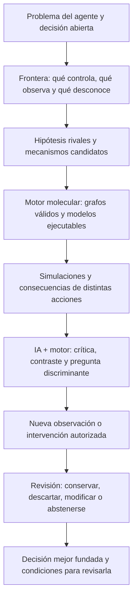

# IGC / CEI + Dinámica de Sistemas — Hoja de ruta v4

## Corrección de rumbo: dejar de probar lo ya probado y examinar el método completo

**Fecha:** 2026-10-18  
**Estado:** propuesta rectora revisada; sustituye la hoja v3 **después de su aceptación**. No es un resultado experimental ni una autorización de merge.  
**Proyecto:** `yudocyudoc/short` · rama estable: `main` · [PR #32 integrado](https://github.com/yudocyudoc/short/pull/32).  
**Antecedentes de dirección:** `CEI_explicación.md`, `CEI_SD_direccionn_actualizada_2026-10-07.md`, `CEI-B v2 — Núcleo metodológico.md` y el historial de experimentos del repositorio.

> **Decisión esencial:** el IGC no busca demostrar que un LLM puede escribir Modelica, conexiones ni AST. **Eso lo hace un motor determinista** con moléculas verificadas. La IA interpreta información, detecta incertidumbres, examina alternativas ya construidas por el motor, contrasta mecanismos, cuestiona supuestos y propone *variantes conceptuales o pruebas*. El motor transforma las propuestas admitidas en estructuras y simulaciones. Estas funciones de la IA **ya tienen pruebas de factibilidad acotada** en la campaña anterior; no vamos a volver a investigarlas como si fueran inéditas.

> **Pregunta que falta:** ¿puede el **sistema integrado** pasar de un problema y una representación incompleta a una explicación dinámica contrastable que **cambie justificadamente una decisión o una pregunta de investigación**, sin recibir la respuesta en el planteamiento y sin consumir más recursos de los que aporta?

---

## 1. Por qué hubo que reescribir esta hoja

La v3 reconocía, en palabras, que debíamos evitar pruebas cuyo resultado estuviera predeterminado. Sin embargo **convirtió de nuevo los componentes de la arquitectura en una lista de experimentos autónomos**. El sistema empezó a cumplir sus propias etapas en lugar de avanzar hacia el objetivo.

Se cometieron tres errores de dirección:

1. **Repetición:** pedir más pruebas aisladas de composición, comparación de hipótesis o crítica de IA aunque sus posibilidades y límites ya estuvieran documentados en PR anteriores. Repetir con otro caso o más variantes no equivale a una nueva pregunta científica.
2. **Asignación equivocada:** en IA-1 (#35) exigimos a Llama un AST ejecutable, sus puertos y sus conexiones. Le devolvimos la construcción formal que justamente habíamos trasladado al motor. Su fallo como constructor no es un fracaso de la función de IA prevista en IGC.
3. **Desalineación de la meta:** puntuar grafos, firmas, clasificaciones y CI sin preguntar **qué aprendió el agente, qué alternativa se descartó legítimamente y qué decisión o prueba cambia**. Un modelo matemáticamente correcto puede no tener ningún valor para el problema.

La corrección **no consiste en agregar protocolos, más casos, otro benchmark de LLM ni un ciclo de revisión más largo**. Consiste en cambiar la pregunta que autoriza el siguiente experimento.

**No se reescriben los resultados** de #33–#35, ni se ocultan sus fallos. Se corrige el uso de esos resultados para decidir qué investigar a continuación.

---

## 2. Objetivo IGC: agente, campo, representación, dinámica y acción

CEI parte de un agente concreto, su representación parcial del campo y su capacidad real de actuar. La dinámica de sistemas aporta mecanismos contrastables cuando stocks, flujos, retardos, restricciones o realimentación alteran el razonamiento. No es obligatorio simular por el mero hecho de tener un problema.

El recorrido mínimo que queremos obtener **como conjunto**, no como seis demostraciones independientes, es:

**El producto mínimo de cada investigación es un dictamen útil para la decisión**, no una cifra de exactitud ni el «grafo ganador». Debe indicar:

- quién decide, con qué objetivo, horizonte y restricciones;
- qué cree ahora el agente y qué evidencia respalda o contradice esa representación;
- qué mecanismos rivales explicarían los hechos; cuáles son indistinguibles con lo disponible;
- qué consecuencias predice cada alternativa para acciones realmente disponibles;
- qué dato o prueba cambiaría la decisión y cuánto costaría obtenerlo;
- qué opción conviene ahora, o por qué debe abstenerse, y qué haría cambiar esa conclusión.

El criterio de valor no es «dibujó un buen diagrama» sino **encontró una diferencia decisional sustentada, redujo una incertidumbre pertinente o evitó una intervención equivocada**. La simulación es un medio y la verdad causal no surge de ajustar una curva.

---

## 3. Registro de capacidades existentes: NO son nuevas hipótesis

Este registro es la barrera contra volver a abrir los mismos experimentos. Una capacidad marcada **demostrada en alcance limitado** puede reutilizarse como componente, regresión o control. **No implica generalización** a cualquier sistema empresarial.

| Capacidad | Evidencia existente | Qué podemos asumir operativamente / qué no hay que repetir |
|---|---|---|
| Moléculas SD, integración Modelica, paridad de stocks y flujos | [#5–#6](https://github.com/yudocyudoc/short/pull/6), [#16](https://github.com/yudocyudoc/short/pull/16), [#17](https://github.com/yudocyudoc/short/pull/17), [#32](https://github.com/yudocyudoc/short/pull/32) | **Reutilizar** ecuaciones y regresiones verificadas. No otro experimento «¿compilan las moléculas?». |
| LLM interpretando/seleccionando/criticando alternativas delimitadas | [#18](https://github.com/yudocyudoc/short/pull/18) (7/8), [#27](https://github.com/yudocyudoc/short/pull/27) (4/4), [#28](https://github.com/yudocyudoc/short/pull/28) (3/4), [#29](https://github.com/yudocyudoc/short/pull/29) (6/8) | **Factibilidad observada en casos propios**, no robustez general. No más «¿puede un LLM revisar o proponer una variante?» como experimento aislado. |
| LLM construyendo directamente estructuras formales | [#19](https://github.com/yudocyudoc/short/pull/19) (0/4), [#25](https://github.com/yudocyudoc/short/pull/25) (caso con topología casi dada), [#26](https://github.com/yudocyudoc/short/pull/26) (0/9 COMPOSE), [#35](https://github.com/yudocyudoc/short/pull/35) (4/18 AST válidos) | **No asignar esta responsabilidad al LLM**. Ni insistir con «probemos otro modelo que escriba mejor el AST». Es una decisión arquitectónica, no una afirmación universal de incapacidad de todos los LLM. |
| Registro molecular, tipado, puertas material/señal, P/Q y separabilidad numérica | [#33](https://github.com/yudocyudoc/short/pull/33): 48 simulaciones, P 15/15 pares separables y Q 14/15 en rejilla P0 | Infraestructura y diagnóstico del universo ensayado. No declarar identificabilidad general ni repetir la matriz como «nuevo método». Umbral de solver aún operativo, no certificado. |
| Compositor extensible por registro | [#34](https://github.com/yudocyudoc/short/pull/34): mismo motor, 6 → 15 AST, 21 simulaciones Modelica y 11 controles Python | **Factibilidad ingenieril acotada**. Se conserva y reutiliza. No otro experimento «15 vs 6» ni confundir cantidad de AST con comprensión. |
| IA-1 / interpretación de evidencias frente a construcción | [#35](https://github.com/yudocyudoc/short/pull/35): baseline 12/18; Llama 4/18 AST admitidos; diagnóstico textual 14/18 **post hoc** | Resultado **mixto**, con defecto de scoring: I1 se condicionó a I2. El 14/18 no sustituye la adjudicación original. Conservar para diagnóstico y arquitectura, **no convertir en nuevo gate que exija otro AST**. |
| Selector de observaciones, pruebas de hipótesis, filtros y variantes | #27–#31 | Existen precedentes técnicos. Algunos resultados eran predeterminados (p. ej., `LAG = diferencia`, tabla de firmas #29 y descarte condicionado #31). **No contar selector aislado, cuatro etiquetas o pruebas redundantes como éxito nuevo**. |

**Conclusión sobre IA:** ya observamos que puede ejercer funciones de interpretación y crítica en condiciones restringidas; también observamos fallos importantes. **No hace falta redescubrir su existencia.** Su contribución en un proceso completo se medirá por el efecto que tenga sobre incertidumbres y decisiones, no por producir un AST correcto ni por superar un cuestionario de etiquetas.

**Conclusión sobre el motor:** sabemos que puede generar grafos válidos para el catálogo pequeño; todavía no sabemos si el conjunto IGC resuelve un problema relevante mejor que alternativas más simples.

**Brecha de integración todavía abierta:** E1 enumera grafos admisibles, pero **no traduce por sí solo una objeción conceptual de la IA a restricciones de la búsqueda**. Falta demostrar o implementar el puente *propuesta conceptual → condición tipada/comprobable → variantes del compositor*, sin que la IA redacte conectores ni se le inyecte un escenario elegido a mano. Ese puente no puede suponerse ya construido ni contabilizarse como otro éxito de composición.

---

## 4. Reparto obligatorio de responsabilidades

| Responsabilidad | Responsable | Salida | Prohibición |
|---|---|---|---|
| Plantear problema, objetivos, agencia y límites | Investigador / declaración del caso; IA puede señalar ambigüedades | Ficha breve de decisión | No inventar meta ni confundir «dato disponible» con hecho verdadero. |
| Registrar evidencia y restricciones; distinguir hecho, inferencia e hipótesis | Capa de procedencia + IA en revisión | Afirmaciones auditables, incertidumbres | No transformar una cita en prueba causal. |
| Proponer *conceptualmente* hipótesis, restricciones o alternativas | IA y heurísticas explícitas | «podría existir un stock entre A y B», «si esto es informacional, no debe modificar stock» | **No escribir Modelica, ecuaciones libres, JSON de instancias ni conexiones como tarea de IA**. |
| Generar y reparar grafos formales | Motor E1 + registro de moléculas + linter; motor de cambios tipados | AST, derivación de conexiones, razón de rechazo | No aceptar construcción por analogía textual sin contratos. |
| Fijar o calibrar parámetros con reglas anunciadas | Motor numérico | Parámetros, rangos, sensibilidad | No ajustar al gold reservado ni ocultar compensaciones. |
| Simular, graficar y proyectar escenarios | OpenModelica + visualizador de AST y trayectorias | Curvas y efectos de intervención | Gráfico bonito ≠ predicción validada. |
| Examinar explicaciones, contradicciones, modelos rivales y pruebas | IA + contraste determinista | Crítica y propuesta **conceptual** de cambio o intervención | No recibir tabla de respuestas/diagnóstico redactado con la solución. |
| Definir verdad, observar resultados ocultos y evaluar utilidad | Evaluador independiente del constructor | Métricas, desenlace de la decisión | Nunca compartir gold ni premiar respuestas generadas por diseño. |

**Interfaz mínima entre IA y motor:** hechos citados, límites de confianza, mecanismo o restricción **en lenguaje causal controlado**, objetivo de la modificación y qué observación lo falsaría. **Su traducción a restricciones del motor es la integración nueva que debe verificarse; no está implementada por el mero hecho de que E1 enumere grafos.** Por ejemplo: «existe evidencia de unidades físicas fuera del almacén sin recepción; incluir como alternativa alguna acumulación *posterior al despacho*», **sin especificar** nombres de puertos ni el modelo verdadero. El motor traduce esa intención a combinaciones tipadas permitidas o declara que no puede.

La IA puede **abstenerse**. El motor también puede indicar **biblioteca insuficiente**. Ninguno de esos resultados se convierte automáticamente en fracaso de todo el método.

---

## 5. Qué sigue sin demostrarse: una sola pregunta nueva

**Pregunta principal pendiente:** dado un *problema de decisión de un agente* y un campo ideal parcialmente observable, ¿puede IGC integrar capacidades conocidas para obtener **una explicación revisable y una decisión/prueba adecuada**, antes de descubrir la verdad completa del mundo, sin que la conclusión esté incorporada en el planteamiento?

**Esto es distinto** de haber demostrado por separado: «un LLM revisa», «OpenModelica ejecuta», «el motor compone», «dos curvas difieren» o «hay un estímulo separador». El resultado nuevo es el **ciclo completo que altera una conclusión útil**.

Para que sea una prueba honesta, el caso debe cumplir estas tres condiciones **antes de ejecutar**:

1. Hay **al menos dos mecanismos plausibles**, compatibles con la información inicial, que inducen **acciones o prioridades de información distintas** desde la posición del agente. Si todas las estructuras llevan a la misma decisión, el catálogo no permite este experimento: **no ejecutarlo**.
2. Existe una observación o intervención acotada que podría inclinar la decisión; el sistema **no recibe qué prueba es la correcta** ni cuál es el mundo real. El evaluador sí conoce la verdad ideal para juzgar el resultado.
3. Existe una respuesta legítima de **insuficiencia**: si la información autorizada no distingue alternativas y la decisión depende de ello, el método debe conservar la incertidumbre, no adivinar una historia convincente.

El caso inicial puede mantenerse en el dominio **pedidos → preparación → despacho → recepción → reporte**, siempre que sus mecanismos disponibles produzcan verdaderas consecuencias de acción distintas. Un contraste entre «acumulación física posterior al despacho» y «retardo sólo del indicador» es un ejemplo de *familias*, **no un mundo o diagnóstico que deba entregarse al participante**.

**Si las moléculas disponibles no permiten plantear alternativas que cambien una decisión**, ésa es una limitación del catálogo, **no** una excusa para llamar «validación» a identificar uno de seis grafos. Puede incorporarse la **mínima pieza matemática necesaria**, verificándola como ingeniería y registrando que se amplió el dominio; no crear una familia entera ni fingir que ya existía.

---

## 6. Siguiente experimento único: X1 — investigación completa en un mundo ideal de decisión

**No abrir nuevas pruebas aisladas de IA ni de composición.** X1 será la primera integración que responda una pregunta del IGC. Sus etapas son fases de **una misma prueba**, no PR científicos independientes.

### 6.1 Preparación mínima, antes del primer resultado

Una sola **ficha de decisión** (máximo una página) establece: agente, objetivo y horizonte; alternativas de acción con consecuencias y costos; información inicial visible; qué puede medir o intervenir; biblioteca/modelos admisibles; presupuesto; parámetro y precisión; criterios para preferir una acción o abstenerse. Definir un conjunto pequeño que incluya **dos mundos con decisiones preferibles diferentes** y **un caso que permanezca indeterminado** bajo la observabilidad asignada. Los mundos se eligen *antes* de evaluar el sistema, no en función de sus aciertos.

La prueba usa un mundo exacto, sin ruido. Eso reduce los confusores y **no pretende probar desempeño en datos reales**. El evaluador conserva la verdad y la respuesta reservada fuera del proceso del investigador automático. No se necesita un framework nuevo: basta un mecanismo auditable de aislamiento y un log de consultas.

**Freno de viabilidad:** antes de programar, comprobar mediante simulación *del lado del evaluador* que (a) la decisión óptima puede variar entre mecanismos/escenarios y (b) no toda incertidumbre se resuelve por una única etiqueta o señal ya visible. Si no ocurre, no tiene sentido iniciar X1 con ese universo. Este chequeo **no se entrega como tabla de respuestas al constructor**.

### 6.2 Ejecución: un ciclo, no una colección de demos

1. **Problema y representación inicial.** El sistema recibe una narración funcional y evidencias permitidas; establece opciones del agente, restricciones, hechos, incertidumbres y condiciones de éxito. La IA ayuda a revisar la formulación, **sin producir AST**.
2. **Alternativas formales.** El motor E1 construye grafos admisibles desde el registro. La IA cuestiona supuestos, reconoce omisiones y solicita *conceptualmente* variantes; el motor decide si son representables y sólo él genera las conexiones.
3. **Proyección y decisión provisional.** OpenModelica simula consecuencias de acciones permitidas. El sistema declara una recomendación provisional, un conjunto de alternativas no descartadas o abstención, **más el motivo**. Si los modelos compatibles recomiendan acciones diferentes, debe decirlo.
4. **Contraste acotado.** Elige **una** medición/intervención pertinente para la decisión con costo declarado; se compromete a ella antes de recibir la respuesta. Se incluye un límite al número de consultas al mundo ideal (como máximo tres respuestas totales por caso, incluida una reservada), no acceso ilimitado.
5. **Actualización real.** Se incorpora la respuesta del mundo y el sistema **revisa la decisión**: conserva, cambia, condiciona o se abstiene. No se premia alterar una estructura por alterar algo; sólo se premia corregir una inferencia o acción de forma sustentada.
6. **Predicción reservada.** Antes de conocer el resultado de una intervención adicional, registra la predicción y el razonamiento desde las alternativas sobrevivientes. El evaluador calcula el desenlace; se compara la recomendación y las consecuencias observables, no únicamente la semejanza de curvas.

**Se conservan todas las ramas de interpretación incompatibles** con información insuficiente. Si no puede elegirse una sola decisión, el informe debe identificar qué información faltaría y por qué; si esa información no está permitida, **termina en abstención sustentada**.

### 6.3 Comparación: contra algo que realmente pueda competir

X1 compara **tres rutas, con el mismo problema, datos y límite de consultas**:

- **A — Análisis simple sin IGC:** usar directamente observaciones y reglas de decisión razonables; no construir un modelo SD si no se necesita.
- **B — Motor SD determinista completo, sin IA:** composición, simulación, comparación de alternativas y selección de pruebas por criterio declarado; **baseline fuerte**, no un muñeco de paja.
- **C — IGC integrado:** mismo motor y presupuesto, con IA realizando interpretación, crítica de supuestos, propuesta conceptual de variantes y revisión de la conclusión.

No hay ventaja de IGC sólo porque C emplea más componentes. Comparar **adecuación de la decisión, manejo de no-identificabilidad, evidencia, costos y número de consultas**. Si B ofrece la misma decisión con menos esfuerzo, eso limita el valor incremental de IA en ese tipo de caso; **no invalida los resultados anteriores de crítica ni la utilidad de otros modelos**.

El primer modelo disponible puede ser Llama. Cuando proceda, evaluar un modelo más capaz **en el mismo papel de revisión conceptual**, nunca como autor de AST; no exigir como prerrequisito otro examen aislado de clasificación o puertos. Registrar original, versión, costo y decisiones, sin extrapolar una corrida a todos los LLM.

### 6.4 Qué contará como resultado nuevo y qué lo refuta

Un resultado informativo de X1 requiere **a la vez**:

- El sistema afronta información incompleta y mantiene rivales de manera honesta; no obtiene el nombre verdadero del caso o una conclusión preconstruida.
- Ejecuta el ciclo completo hasta una decisión, una pregunta útil o una abstención justificada; **la recomendación tiene un contrafactual comprensible** («si el mecanismo fuera B, haría otra cosa»).
- Una nueva observación puede **confirmar o cambiar** al menos una conclusión y las trayectorias/decisiones reservadas no contradicen lo que se afirmó dentro de la tolerancia declarada.
- No produce falsas certezas en el caso no identificable; todos los resultados y fallos se informan, no sólo el mundo favorable.
- El resultado es comparado con A y B, incorporando el costo de inferencia/consultas. Una ventaja de C **no se presume**.

**Fallo genuino** si el método atribuye una causa que la observación no identifica, recomienda actuar de forma incorrecta cuando hay alternativas observacionalmente indistinguibles, recibe la solución en el prompt, consume consultas fuera de presupuesto, o sólo coincide con un mundo porque lo enumeró todo y después le entregaron la respuesta. **Resultado neutro** si A o B bastan y C no agrega nada; no inventar «impacto» para conservar IA.

**Métricas mínimas:** elección y su justificación; arrepentimiento/costo de decisión frente al óptimo del mundo ideal cuando pueda calcularse; descartes injustificados; cobertura de hipótesis compatibles; errores de predicción reservada; consultas/costo y tiempo; valor incremental de C frente a A/B. Reportar por mundo; **no declarar significancia estadística con una muestra pequeña**.

---

## 7. Después de X1: transferencia sólo si cambió algo real

Si X1 funciona de manera informativa, el siguiente reto **no es repetir más mundos con las mismas seis arquitecturas**. Es transferir el **ciclo de investigación y decisión** a una estructura con al menos una relación que la cadena de pedidos no contiene: una política intermodular o un feedback agente–campo que cambie la opción óptima a lo largo del tiempo.

Ejemplo posible: capacidad y espera en una cafetería; una intervención del dueño modifica colas/servicio, que a su vez afectan futuras entradas o retorno. No es necesario modelar toda la ciudad ni incorporar automáticamente sensores nuevos. Preguntar primero si SD añade algo a una tabla o a una conversación. Ampliar biblioteca **sólo si el mecanismo indispensable no existe**.

**Más adelante**, con el ciclo ideal demostrado y sin sacrificar utilidad decisional: introducir datos incompletos/contradictorios y un piloto de negocio con comparación frente a un análisis convencional, según la dirección del 7 de octubre. Esto no se declara logrado anticipadamente.

Si X1 no aporta una decisión o pregunta mejor que A/B, **detener la expansión** y examinar si el IGC aporta valor en otra clase de incertidumbre; no aumentar complejidad para forzar resultados.

---

## 8. Qué hacemos con los PR abiertos y con la hoja v3

| Referencia | Tratamiento recomendado | Motivo |
|---|---|---|
| `main` y [#32](https://github.com/yudocyudoc/short/pull/32) | Conservar la fundación. | Ya es la base estable. |
| [#33 — E0](https://github.com/yudocyudoc/short/pull/33) | Conservar como infraestructura de contratos, observabilidad y controles; integrar sólo cuando se revise su alcance técnico. | Matriz P/Q ≠ prueba de método. |
| [#34 — E1](https://github.com/yudocyudoc/short/pull/34) | Conservar como compositor por registro para X1; integrar técnicamente sin reabrir S2 como «nuevo descubrimiento». | Extensibilidad acotada ya probada. |
| [#35 — IA-1](https://github.com/yudocyudoc/short/pull/35) | **No usar como dependencia metodológica ni repetirlo.** Mantener sus archivos, logs, fallo de AST y defecto de scoring como historia auditable. | Probó en gran medida una tarea asignada incorrectamente a Llama. |
| Hoja v3 en `docs/` | Archivar como versión superada; la v4 es rectora **si el investigador la aprueba**. | La v3 no impidió repetir investigaciones conocidas. |

**No abrir otra rama de experimentos sólo para probar un subcomponente de X1.** La nueva implementación puede apoyarse en #33/#34 después de integrar las piezas técnicas revisadas; no debe continuar la cadena sobre #35. La reordenación de PR es administrativa, no evidencia científica, y requiere una decisión separada sobre merges.

---

## 9. Cinco reglas operativas que sí detienen la deriva

1. **Novedad obligatoria:** antes de abrir un PR, completar una sola frase: «Esto aún no está probado porque ___; cambiaríamos nuestra conclusión si ___». Si describe algo ya mostrado por #18–#35, **no se abre**.
2. **IA fuera del cableado:** IA revisa, contrasta y propone variantes conceptuales; **no escribe** Modelica, ecuaciones, conectores ni AST como mecanismo de éxito. Cambiar este reparto requeriría una decisión explícita nueva, no un prompt improvisado.
3. **La respuesta no va en el planteamiento:** si el caso, el evaluador o las opciones visibles predeterminan el acierto, no se puntúa como método. Un caso demasiado simple se declara no informativo **antes de ejecutar**; no se arregla tras mirar la respuesta.
4. **Toda prueba termina en decisión, incertidumbre o parada:** «CI PASS», «18/18 grafos válidos» y «el LLM acertó una etiqueta» son resultados técnicos, no una contribución IGC. Lo nuevo debe afectar la interpretación del problema o una acción justificable.
5. **Valor y costo:** ante el mismo dato y presupuesto, comparar con análisis simple y motor sin IA. Si las partes sofisticadas no aportan a la decisión, simplificarlas; no añadir protocolos, casos ni familias para justificar el trabajo previo.

---

## 10. Instrucción única para el siguiente ciclo de trabajo

**No ejecutar más pruebas de «¿puede Llama modelar?» ni de «¿puede Llama criticar un grafo?» ni de «¿puede el compositor agregar otro bloque?».** Eso ya tiene evidencia y límites documentados.

Preparar **una ficha de decisión X1** con **dos mecanismos rivales que lleven a acciones diferentes**, capacidad real de observar o intervenir, un caso ambiguo y un baseline fuerte. Usar sólo las moléculas necesarias. Si el catálogo actual no representa la decisión sin inventar una solución, **declarar qué pieza falta** y decidir si incorporarla aporta más valor que abandonar ese escenario.

Una vez fijada esa ficha, realizar **una única prueba integrada**, con IA en su papel de investigadora/crítica y el motor como autor exclusivo de la estructura formal. El resultado se evalúa por explicación y decisión revisables, no por el número de experimentos completados.

**Esta es la nueva frontera de investigación del IGC.**

---

### Fuentes internas y trazabilidad

- `CEI_explicación.md`: agente en múltiples campos, representación parcial, mecanismos e intervención.
- `CEI_SD_direccionn_actualizada_2026-10-07.md`: criterio de utilidad decisional, límites del modelado y comparación con análisis convencional.
- `CEI-B v2 — Núcleo metodológico.md`: procedencia, contraste entre percepción/reconstrucción, alcanzabilidad y actualización.
- `IGC_SD_HOJA_DE_RUTA_CONSOLIDADA_v3_2026-10-18.md`: documento sustituido por esta corrección cuando se apruebe.
- PR históricos #5–#31 y fundación #32; experimentos #33 (E0), #34 (E1), #35 (IA-1), preservados en GitHub sin alterar los resultados.
