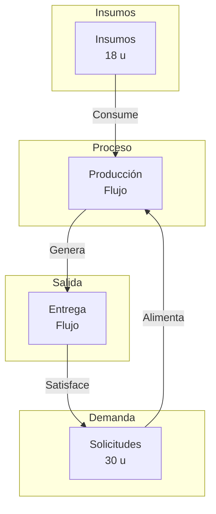

1. **Stocks y flujos**

| Nombre | Tipo | Unidad | Justificación |
| :--- | :--- | :--- | :--- |
| **Insumos** | Stock | Unidades (bebidas) | Acumula la capacidad física disponible para producir. |
| **Solicitudes** | Stock | Unidades (bebidas) | Acumula la demanda no atendida en el tiempo. |
| **Producción** | Flujo | Unidades (bebidas) | Cantidad de bebidas que pasan del estado de insumo a terminado. |
| **Entrega** | Flujo | Unidades (bebidas) | Cantidad de bebidas que salen del sistema para ser consumidas. |

2. **Diagrama mínimo**

3. **Restricciones y consecuencias**

1.  **Capacidad Máxima de Producción:** Dado que la máquina opera a 12 bebidas por hora durante 2 horas, la producción máxima teórica es $12 \times 2 = 24$ unidades.
2.  **Límite de Insumos:** La producción real no puede superar los 18 unidades disponibles, ya que no hay reposición de insumos.
3.  **Límite de Demanda:** La producción real no puede superar las 30 solicitudes, ya que es la cantidad total de demanda registrada.
4.  **Producción Real:** La producción efectiva ($P$) está acotada por la intersección de los tres límites: $P \le \min(24, 18, 30)$. Por lo tanto, $P \le 18$.
5.  **Estado Final de Stocks:** Al final del periodo, los insumos serán cero ($I_{final} = 0$). Las solicitudes pendientes ($S_{final}$) serán $30 - P$. Dado que $P \le 18$, al menos 12 solicitudes permanecerán pendientes.

4. **Retroalimentaciones**

-   **No hay evidencia de bucles endógenos:** El modelo describe un sistema lineal de flujo con límites físicos. No se infiere que la espera afecte la tasa de producción ni que la producción afecte la tasa de solicitudes, ya que no se proporcionan datos sobre tiempos de espera, cansancio del operario o comportamiento del cliente.
-   **Candidata a investigar:** La relación entre la velocidad de producción (12 u/h) y la velocidad de llegada de solicitudes (30 u en 2 h = 15 u/h promedio). Si la producción fuera más rápida que la llegada, las solicitudes se acumularían; si fuera más lenta, se agotarían los insumos antes de terminar la demanda. Sin embargo, el modelo actual no modela la velocidad de flujo, sino solo la capacidad máxima.

5. **Información faltante**

-   **Tasa de llegada de solicitudes:** Para modelar la dinámica temporal (cuándo llegan las 30 solicitudes), se necesita la distribución temporal o la tasa de llegada.
-   **Tiempo de preparación por bebida:** Para saber si la máquina opera a su máxima capacidad (12 u/h) o si hay tiempos muertos, se necesita el tiempo de ciclo unitario.
-   **Tiempo de entrega:** Para saber si las bebidas se entregan inmediatamente o si se forman colas de espera físicas, se necesita el tiempo de despacho.
