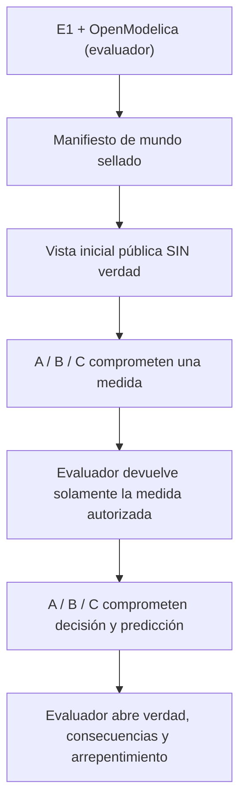

# X1 — Primer ciclo integrado de decisión IGC v4

**Pregunta:** bajo incertidumbre sobre la posición de un cuello de botella físico, ¿puede IGC producir y revisar una decisión de inversión mejor que un análisis simple o un motor numérico sin IA, descontando el costo de observación?

[Contrato y límites](CONTRACT.md) · [Hoja v4, PR #36](https://github.com/yudocyudoc/short/pull/36) · [Dependencia técnica E1, PR #34](https://github.com/yudocyudoc/short/pull/34).

El código de E1 produce exclusivamente los grafos/instancias Modelica. X1 compara dos **localizaciones alternativas del cuello de botella**, con **tres acciones y seis casos secretos**; uno no permite medir. El evaluador comprueba ANTES de cualquier llamada a IA que las dos localizaciones favorecen inversiones opuestas, y detiene la prueba si no sucede.

El circuito de GitHub Actions utiliza jobs separados:

La **IA sólo realiza crítica y decisión conceptual**. Nunca redacta Modelica, ecuaciones ni AST. El brazo A usa una revisión de salidas operativas, B optimiza valor de información con contrafactuales Modelica y C usa Llama 3.3 70B sobre **los mismos modelos y observaciones**, con hasta dos llamadas por caso. Un C más caro y no mejor que B **es un resultado negativo válido**.

La verdad se elige con entropía privada del runner, se compromete con hash salado y no se descarga en los jobs de participantes. Los originales y los fallos se guardan por artefacto. El juez abre la verdad **después** de comprometer predicciones. Límite de este mundo ideal: ambos candidatos pertenecen al mismo catálogo explícito y comparten ecuaciones con el evaluador; no se afirma descubrimiento abierto o validez empresarial.

Pruebas locales sin red: `python -m unittest discover -s experiments/x1 -p 'test_*.py' -v`. La corrida completa requiere el workflow `igc-v4-x1.yml` y una autorización explícita por commit de mensaje exacto; no hay corridas exploratorias oportunistas después de ver la verdad.
