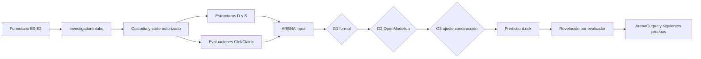

# CEI–IGC — Contratos v0.1 · Investigación y ARENA

**Estado:** borrador exploratorio, no contrato de producción ni etapa CEI-B aprobada.
**Frontera:** el formulario no consulta fuentes originales, no construye estructuras y no ejecuta Modelica, Clef, Clairic ni SD-AI.

## 1. Por qué dos entradas

`InvestigationIntake` cubre E0–E2: decisión/pregunta, actor focal, frontera, propósito declarado, campo percibido (registrado antes de exponer hallazgos), permisos, observabilidad y procedencia. El investigador puede completarlo sin escribir ninguna ecuación ni elemento de ATMS. Se acepta ausencia de datos; no se crea evidencia sintética para rellenar.

`ArenaInput` es un **paquete posterior**: recibe referencias a estructuras candidatas `D` y `S`, y a propuestas evaluativas/paramétricas `P` (`Clef`, `Clairic`, estimador determinista). Estas salidas se guardan con ID, versión y linaje. No se mezclan las tres vías en un mecanismo promedio. Se registra un baseline convencional fuerte para medir el valor incremental. La interfaz solamente ensambla el paquete; el validador y el custodio deben hacerlo apto para ejecución.

## 2. Especificaciones de entrada

- `contracts/investigation_intake.schema.json`: `igc.investigation_intake.v0.1`
- `contracts/arena_input.schema.json`: `igc.arena_input.v0.1`

**Invariantes:**

1. Toda pregunta investigadora tiene caso, frontera y horizonte; actor observador no recibe permiso ficticio de intervención.
2. Cada observable identifica estado (`observed`, `proxy`, `latent`, `unmeasured`), unidad, resolución, error y retraso. Se permite `UNKNOWN`; una predicción nunca convierte un latente en observado.
3. `as_known_at` representa **tiempo de conocimiento**, no simplemente fecha de evento. Las fuentes visibles son *referencias*, no texto bruto.
4. La reserva se separa **antes de extracción, indexación y recuperación** accesibles a constructores. Solo la referencia opaca puede aparecer en el paquete. En este prototipo `server_isolation_verified=false`: la custodia real NO está implementada.
5. La primera ronda separa respuestas D, S y P; la sección ARENA registra `rival_outputs_hidden_until_round_closed=true`, pero el aislamiento efectivo es responsabilidad de procesos posteriores.
6. `StructureProposal` D/S y `Assessment/ParameterProposal` P **son tipos distintos**. Los juicios de Clef no se convierten en topologías por coerción. Los valores estimados de Clairic no sustituyen cálculos exactos.
7. Los tres gates quedan `NOT_RUN` en los paquetes del navegador: **G1** semántica/formalidad, **G2** compilación/ejecución/invariantes, **G3** adecuación solo con datos de construcción. Los verifican motores separados.
8. Una predicción se congela con su `candidate_id`, rango paramétrico, observable, horizonte, condiciones y hash **antes** de que un evaluador tenga permiso para revelar la reserva.
9. Sin equivalencia falsa: `COMPILATION_FAILURE` ≠ `REFUTED_BY_OBSERVATION`. Un resultado sin observabilidad discriminante queda `NOT_DISCRIMINATED`.
10. La interfaz no declara READY_FOR_SIMULATION: `DRAFT_PENDING_EXTERNAL_GATES` es intencional hasta integrar el custodio y los gates.

## 3. Contrato de salida de ARENA

`contracts/arena_output.schema.json`: `igc.arena_output.v0.1`

La salida real, que **este prototipo no genera**, es responsabilidad del evaluador. Incluye:

- Por candidato: origen, resultado separado de G1/G2/G3, ejecuciones por conjunto de parámetros y referencias a trayectorias de los observables.
- Estado empírico por candidato: `NOT_TESTED`, `COMPATIBLE_WITH_HELDOUT`, `REFUTED_BY_OBSERVATION`, `NOT_DISCRIMINATED`, `NOT_IDENTIFIABLE`, `INSUFFICIENT_OBSERVATION`.
- Competencia posterior a simular: clases de equivalencia observacional, observables que distinguen, o imposibilidad de discriminación. No votación entre modelos.
- Plan de próxima medición/prueba: pregunta, variables, autorización, costo conocido o desconocido.
- Auditoría: hash de contrato de entrada, versión del snapshot, referencia a apertura de reserva y fecha del evaluador.

**Nota epistemológica:** compatible con la reserva no es causa demostrada. Si ambas estructuras explican el tramo reservado y no existe una prueba discriminante accesible, conservar ambas e identificar la insuficiencia.

## 4. Flujo mínimo de validación (pendiente de implementación)

La verdadera custodia del holdout está **fuera** de este gráfico de UI: comienza antes de `InvestigationIntake` si ya existen datos históricos con porciones reservadas.

## 5. Contratos aún no codificados (no fingir que existen)

- `EvidenceRecord`, `SnapshotView`, `ATMSView`, `TypedIR`, `ParameterSet`, `ModelExecution`, `PredictionLock` con hashes inmutables.
- Validación semántica de fronteras, unidades, causalidad y equivalencia observacional.
- Control de autenticación y roles, almacenamiento privado con D1/R2, auditoría append-only; servicios separados de custodio/evaluador.
- Seguridad y política de costos para llamadas a IA y ejecución OpenModelica.
- Evaluación comparativa: baseline sencillo fuerte, cada vía, combinaciones y costo incremental.

## 6. Ruta de implementación sugerida

1. Validar con investigador la captura E0, observabilidad y condiciones de reserva (sin producción ni datos sensibles).
2. Añadir endpoint de recepción autenticado **solo para borradores** y persistencia con versiones (nunca holdout en la misma tabla/index del constructor).
3. Incorporar resolver de referencias a candidatos y resultados de P (no entrada manual de resultados como autoridad).
4. G1 por linter actual / IR; G2 OpenModelica; G3 con datos de construcción; registro de errores tipados.
5. Custodio bloquea predicción y libera reserva solo después del lock.
6. Emitir `ArenaOutput`, abrir seguimiento versionado y medir costo/valor frente a baseline.

**Prototipo actual:** solo interfaz y serialización JSON. No hay red, almacenamiento, autenticación, compilación, validación de motor ni adjudicación.

