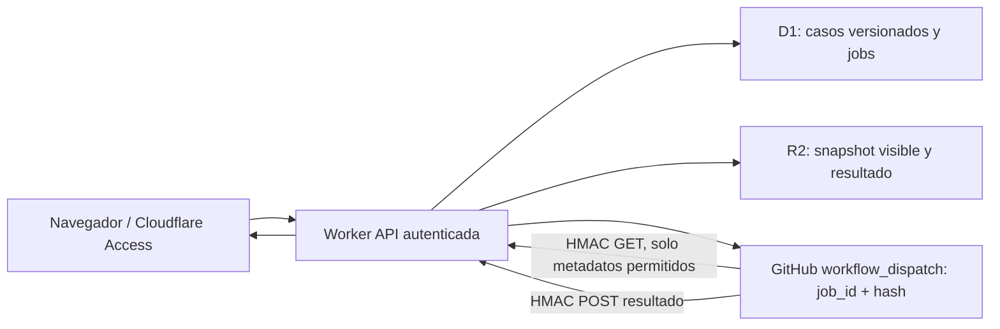

# CEI–IGC · Mesa full-stack Cloudflare + ejecutor GitHub v0.2

**Worker v0.2 activo en Cloudflare.** Este PR incorpora el código fuente, contratos, frontend y workflow al repositorio. El Worker no se vuelve a desplegar al fusionar. El ejecutor solo admite una **sonda determinista sin llamadas a IA ni Modelica**.

## División de responsabilidades

- **Cloudflare:** sirve frontend y `/api/*`, autentica con JWT verificado de Cloudflare Access, guarda versiones de borradores en D1, archiva snapshots de entrada y resultados en R2, lanza únicamente el workflow permitido.
- **GitHub Actions:** recoge el snapshot de Cloudflare con firma HMAC, verifica hash/contrato y envía un resultado firmado. Nunca recibe contenidos reservados; aquí no ejecuta OpenModelica ni modelos IA.
- **ARENA futura:** G1, G2, G3, predicciones congeladas y adjudicación empírica **siguen en `NOT_RUN`**. El probe valida solo la conexión entre servicios.

## Arquitectura actual

## Instalación en Cloudflare

Necesitas cuenta Cloudflare con **Workers, D1, R2 y Cloudflare Access** habilitados. El proyecto deliberadamente **no funcionará con datos privados hasta que Access y D1/R2 estén configurados**.

1. En esta carpeta: `npm install` y `npm test`.
2. Crea D1: `npx wrangler d1 create cei-igc-lab-v02`. Copia el `database_id` a `wrangler.jsonc`.
3. Crea R2: `npx wrangler r2 bucket create cei-igc-lab-v02` (o usa un bucket existente y cambia su binding).
4. Migra: `npm run db:migrate:local`; para remoto, después de revisar el esquema: `npm run db:migrate:remote`.
5. La aplicación **Cloudflare Zero Trust > Access > Applications** protege las rutas humanas del Worker. Mantén la política de investigador y el path override existente para `/api/runner/*`. Configura `ACCESS_TEAM_DOMAIN` y `ACCESS_AUD` como secretos de Wrangler; el Worker **verifica criptográficamente JWT, firma, issuer y audience**.
6. Crea un token **GitHub App** (ideal, rotación de installation tokens) o token de alcance mínimo **Actions: write** para el repo `yudocyudoc/short`. En Cloudflare: `npx wrangler secret put GITHUB_TOKEN`.
7. Define una cadena aleatoria robusta (al menos 24 caracteres, preferiblemente 32 bytes aleatorios) como `IGC_RUNNER_HMAC_SECRET`: `npx wrangler secret put IGC_RUNNER_HMAC_SECRET`. **La misma cadena** debe configurarse como secreto de GitHub Actions; no la guardes en `wrangler.jsonc`.
8. Revisa `GITHUB_REPO`, `GITHUB_REF`, `GITHUB_WORKFLOW` y deja este último fijo a `igc-arena-probe.yml`.
9. El Worker ya está desplegado; este PR no ejecuta `npm run deploy` ni modifica Cloudflare.

### Configuración en GitHub

- Este PR instala el workflow en `.github/workflows/igc-arena-probe.yml` y el runner en `tools/igc-arena-probe.py`. Se conservan las copias de `github/` como plantillas fuente.
- Añade el secreto GitHub Actions `IGC_RUNNER_HMAC_SECRET` idéntico al de Cloudflare.
- Añade la variable GitHub Actions `IGC_SERVICE_ORIGIN=https://<host-exacto-de-tu-worker>`.
- Revisa este PR y CI antes de integrarlo. La integración no estará activa en `main` hasta el merge; el workflow seguirá siendo manual.
- El Worker no envía `return_run_details` en el cuerpo del dispatch. Conserva la lectura de `workflow_run_id` y URL si la respuesta de GitHub las incluye; si no, mantiene el UUID del job y espera el callback firmado.

### Prueba local

`npm run dev` sirve la página, pero el API de datos privados devuelve acceso denegado hasta contar con **un JWT real de Cloudflare Access**. No existe bypass anónimo en producción ni en local. Los tests de Node inyectan un usuario de prueba sin deshabilitar el mecanismo real de Access.

## Rutas

| Método y ruta | Seguridad | Función |
|---|---|---|
| `GET /api/health` | pública, sin datos | Estado de servicio |
| `GET /api/me` | JWT Access válido | Identidad verificada |
| `GET /api/github/auth-check` | Access, investigador autenticado | Comprueba token y lectura del workflow con solicitudes GitHub GET; no inicia ejecuciones ni devuelve credenciales |
| `GET /api/cases` | Access, por propietario | Lista de casos |
| `POST /api/cases` | Access | Crea borrador |
| `GET/PUT /api/cases/:id` | Access, por propietario | Leer/actualizar con versionado optimista |
| `POST /api/cases/:id/runs` | Access, por propietario | Encola solo `DETERMINISTIC_PROBE` |
| `GET /api/cases/:id/runs` | Access | Lista de ejecuciones |
| `GET /api/runs/:id` | Access | Estado y URL GitHub, polling opcional |
| `GET /api/runs/:id/result` | Access | Resultado verificado, desde R2 |
| `GET /api/runner/jobs/:id/snapshot` | HMAC compartida | Snapshot con hash, sin holdout |
| `POST /api/runner/jobs/:id/result` | HMAC compartida | Callback resultante, sin ejecutar modelos |

## Fronteras metodológicas y de seguridad

1. El backend **solo acepta los contratos v0.1 en modo borrador**. La indicación `BROWSER_ONLY_NO_STORAGE` en `provenance` describe el origen de autoría de ese contrato; el servidor agrega separadamente versionado y custodia de almacenamiento. Una futura migración v0.2 debe renombrar este campo para evitar confusión.
2. El holdout se registra como **referencia opaca exclusivamente**. No hay endpoint de carga, búsqueda o revelación de reservas; `server_isolation_verified=false`. Este proyecto **no implementa un custodio real** ni debe emplearse para afirmarlo.
3. No se permite enviar gold, contenidos de holdout o salidas que declaren G1/G2/G3 aprobadas. Tampoco se aceptan workflows arbitrarios desde el navegador.
4. Cada job fija un snapshot inmutable con SHA-256. El runner lo recupera y devuelve un resultado autenticado por HMAC-SHA256 con vigencia de cinco minutos. El resultado queda en R2 y en D1 únicamente se registra su referencia y estado.
5. Ninguna de las tres vías (D, P, SD-AI) está conectada aún: la sonda no califica ni modela investigación. **Un PASS técnico del probe no equivale a validez metodológica ni capacidad de explicación sistémica**.
6. En Cloudflare, solo `/api/runner/*` queda accesible sin inicio de sesión mediante el path override de la aplicación Access. El Worker exige HMAC con tiempo y hash en ambas rutas del runner. Las demás rutas de la aplicación siguen protegidas por Access; el runner no envía tokens Service Auth.
7. Está prohibido indexar fuentes reservadas en Vectorize o meterlas en prompts/snapshots de las vías. Falta construir custodia real antes de permitir reservas sensibles.
8. D1 y R2 se conectan solo al Worker; las credenciales GitHub y HMAC son **secrets**, nunca variables frontend. GitHub Actions consume minutos/recursos y se mantuvo en modo no pagado de modelos; un futuro modo de IA requerirá autorización independiente.

## Pendiente

- Revisión del contrato de custodia y evaluación ciega real.
- Backend de extracción/procedencia, ATMS, linter, propuestas SD-AI, evaluaciones Clef/Clairic, adaptador IR, G1/G2/G3 y Modelica.
- Cloudflare Workflows para coordinación duradera de rondas completas; esta versión usa D1 + callback/polling porque solo integra una tarea de prueba.
- Tests de integración reales con Cloudflare Access, GitHub Actions y callbacks luego de configurar cuentas.
- Límites de costos, auditoría append-only y diferenciación de roles/custodio en producción.

